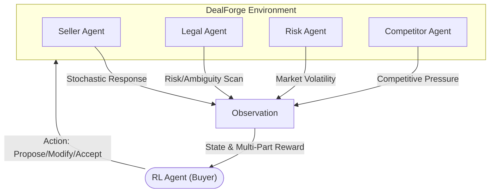

<div align="center">
  <h1>🤝 DealForge OpenEnv</h1>
  <p><strong>A Production-Grade Reinforcement Learning Framework for Multi-Agent Commercial Negotiation</strong></p>

  [](https://www.python.org/downloads/)
  [](https://github.com/OpenEnv)
  [](https://opensource.org/licenses/MIT)
</div>

---

## 🚀 Overview

**DealForge** is a high-fidelity negotiation environment designed to bridge the gap between simple game-theory models and complex real-world commercial contracting. Built on the **OpenEnv MCP (Modular Control Plane)** architecture, it simulates a high-stakes negotiation between a Buyer (RL Agent) and a multi-faceted Seller organization.

### Why DealForge?
- 🎭 **Stochastic Realistic Agents**: Internal agents (Seller, Legal, Risk, Competitor) respond with non-linear, probabilistic behaviors.
- ⚖️ **Composable Reward Engine**: Decomposes performance into Success, Progress, Fairness, Risk, and Efficiency.
- 🌪️ **Dynamic Pressure**: Simulated market shocks and competitor intensity that drift over time.
- 🏗️ **Ready for GRPO/TRL**: Optimized for Group Relative Policy Optimization and other large-scale RL training pipelines.

---

## 📊 Performance Showcase

<div align="center">
  <table>
    <tr>
      <td width="50%">
        
        <p align="center"><i>Figure 1: Reward Convergence Curve</i></p>
      </td>
      <td width="50%">
        
        <p align="center"><i>Figure 2: Success Rate vs. Deal Quality</i></p>
      </td>
    </tr>
    <tr>
      <td width="50%">
        
        <p align="center"><i>Figure 3: Multi-Component Reward Decomposition</i></p>
      </td>
      <td width="50%">
        
        <p align="center"><i>Figure 4: RL Learning Efficiency Heatmap</i></p>
      </td>
    </tr>
  </table>
</div>

---

## 🏗️ Architecture

DealForge utilizes a modular controller architecture where the observation space is shaped by multiple internal experts.



---

## 🛠️ Key Components

| Component | Responsibility | Key Metrics |
| :--- | :--- | :--- |
| **Seller Agent** | Stochastic deal evaluation & counter-offers | `accept_prob`, `trust_score` |
| **Legal Agent** | Contract clause ambiguity & penalty assessment | `legal_risk`, `missing_fields` |
| **Risk Agent** | Innovation inertia & market uncertainty tracking | `risk_score`, `volatility` |
| **Competitor Agent** | External market shocks & competitive drift | `external_pressure`, `shock_scale` |
| **Reward Engine** | Aggregating complex signals into a stable RL scalar | `fairness`, `efficiency`, `progress` |

---

## ⚙️ Installation

```bash
# Core Environment
python -m pip install openenv-core pyyaml

# Training Dependencies (TRL/GRPO)
python -m pip install "trl>=1.0.0" "transformers>=4.46.0" "datasets>=2.20.0" \
                      peft accelerate bitsandbytes matplotlib pyyaml
```

---

## 🏃 Usage

### 1. Basic Interaction
```bash
python examples/run_openenv_dealforge.py
```

### 2. High-Performance Training (GRPO)
```bash
python training/train_dealforge_grpo_colab.py \
  --config configs/dealforge_default.yaml \
  --model Qwen/Qwen2.5-0.5B-Instruct \
  --output_dir outputs/dealforge_grpo_run \
  --train_prompts 128 \
  --eval_episodes 40
```

### 3. Generate Analysis Plots
```bash
python training/plot_training_results.py \
  --baseline outputs/dealforge_grpo_run/baseline_metrics.json \
  --trained outputs/dealforge_grpo_run/trained_metrics.json \
  --out_dir outputs/dealforge_grpo_run
```

---

## 📜 Project Structure

- `dealforge/` - Core logic for Environment, Models, and Reward Engine.
- `training/` - TRL/GRPO training scripts and evaluation utilities.
- `configs/` - Hyperparameter and scenario configurations.
- `logs/` & `outputs/` - Performance metrics, transcripts, and checkpoints.
- `assets/` - README visualizations and documentation media.

---

<div align="center">
  <p>Built with ❤️ for the RL Community</p>
</div>
