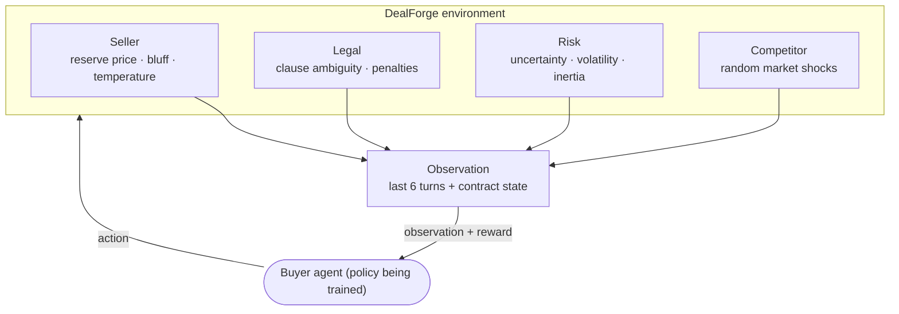
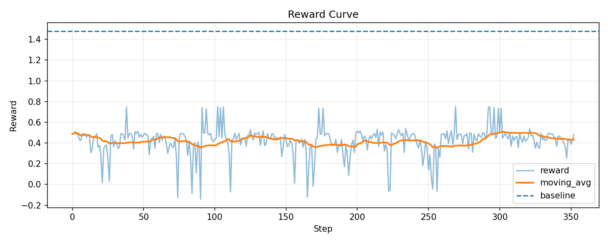
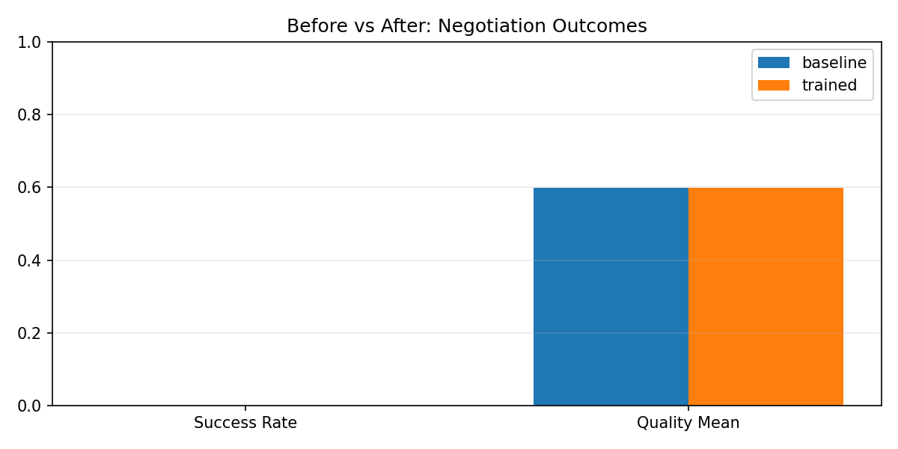
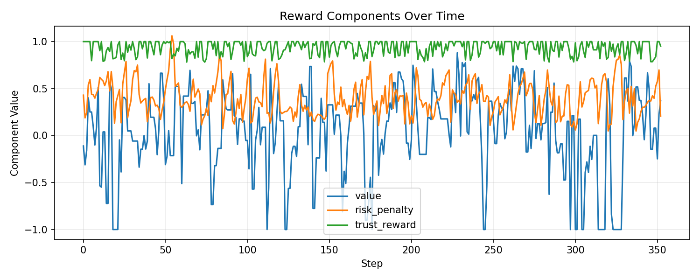
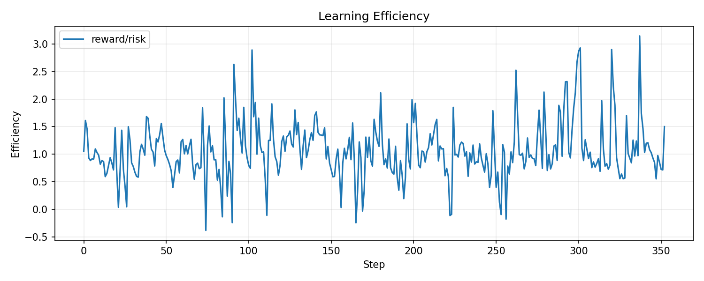

<div align="center">

# 🤝 DealForge

**A reinforcement-learning environment for commercial negotiation. A buyer agent learns to close good, fair, low-risk deals against a seller, a legal team, a risk desk and a competitor.**

[](https://www.python.org/)
[](#openenv-interface)
[](https://huggingface.co/docs/trl)
[](https://huggingface.co/docs/transformers)

[Why](#why) · [The environment](#the-environment) · [Rewards](#reward-design) · [Quick start](#quick-start) · [Train an LLM](#train-an-llm-buyer) · [Results](#results)

</div>

---

## Why

Most negotiation benchmarks are one-shot price games. Real B2B deals are different:

- The other side has its own **reserve price, bluffing style and patience**.
- **Legal** flags vague clauses, and **risk** keeps moving with the market.
- A **competitor** can show up mid-deal and change the leverage.
- A deal that is closed fast but unfairly, or with a hidden liability, is a **bad deal**.

DealForge puts all of that into one environment, so an agent (classic RL or an LLM) has to learn the whole trade-off and not a single number.

## The environment



**The buyer's actions:** `propose_contract`, `modify_clause`, `ask_question`, `delay_negotiation`, `accept_deal` and `reject_deal`.

**Every episode is different.** Each reset samples a fresh scenario from `configs/dealforge_default.yaml`:

| Randomised | Range |
|---|---|
| Horizon | 10 to 30 turns |
| Market uncertainty | 0.10 to 0.95 |
| Competitor intensity | 0.05 to 0.95 |
| Seller minimum price | 0.20 to 0.95 |
| Seller bluff factor | 0.0 to 1.0 |
| Seller style | direct, guarded, collaborative or adversarial |
| Latent liability | 0.0 to 1.0 |

Contracts are versioned. Every proposal creates a new `ContractVersion` with its own clauses (pricing, SLA and so on), so you can trace the whole negotiation history.

## Reward design

The reward engine breaks each step into **five components**, which keeps the learning signal dense and easy to read:

| Component | Rewards the buyer for |
|---|---|
| **Success** | closing a deal at all |
| **Progress** | moving terms toward agreement |
| **Fairness** | a price both sides can accept, not a squeeze |
| **Risk** | keeping legal and market risk low |
| **Efficiency** | not wasting turns |

Invalid actions are penalised. Each component is logged separately, so you can see *why* a policy improved.

## Quick start

```bash
git clone https://github.com/kartikeyajay2006/RL-model-Negotiation.git
cd RL-model-Negotiation
pip install openenv-core pyyaml matplotlib

python examples/run_random_episode.py       # a random buyer, step by step
python examples/run_openenv_dealforge.py    # the same, through the OpenEnv interface
```

```python
from dealforge.config import DealForgeConfig
from dealforge.env import DealForgeEnv

env = DealForgeEnv(DealForgeConfig.from_yaml("configs/dealforge_default.yaml"), seed=42)
obs, info = env.reset()
result = env.step({"action_type": "ask_question",
                   "payload": {"target_agent": "seller", "question_type": "pricing"}})
print(result.reward, result.terminated, result.info)
```

## OpenEnv interface

`dealforge/openenv_environment.py` wraps the environment in the OpenEnv model-context style (typed models in `openenv_models.py`), so it can be served and trained like any other OpenEnv environment.

## Train an LLM buyer

The training script fine-tunes a causal language model as the buyer with **TRL PPO** (value head and KL control). It runs on a free Colab GPU.

```bash
pip install "trl" "transformers>=4.46" datasets peft accelerate bitsandbytes

python training/train_dealforge_grpo_colab.py \
  --config configs/dealforge_default.yaml \
  --model Qwen/Qwen2.5-0.5B-Instruct \
  --output_dir outputs/run1 \
  --train_prompts 128 --eval_episodes 40
```

It evaluates the policy before and after training and writes `baseline_metrics.json` and `trained_metrics.json`. Plot the comparison with:

```bash
python training/plot_training_results.py \
  --baseline outputs/run1/baseline_metrics.json \
  --trained  outputs/run1/trained_metrics.json \
  --out_dir  outputs/run1
```

## Results

<table>
<tr>
<td width="50%"><p align="center"><sub>Reward over training</sub></p></td>
<td width="50%"><p align="center"><sub>Success rate versus deal quality</sub></p></td>
</tr>
<tr>
<td width="50%"><p align="center"><sub>Reward by component</sub></p></td>
<td width="50%"><p align="center"><sub>Learning efficiency</sub></p></td>
</tr>
</table>

`logger.py` and `plot.py` record every episode to JSON and CSV (see `logs/`), so a run can be analysed again without retraining.

## Project structure

```text
dealforge/
  env.py                  DealForgeEnv: reset, step, scenario sampling, contract versions
  internal_agents.py      seller, legal, risk and competitor behaviour
  reward_engine.py        five-component reward
  models.py               Action, Clause, ContractVersion, Event, StepResult
  openenv_environment.py  OpenEnv wrapper
configs/dealforge_default.yaml   every scenario range and agent parameter
training/                 PPO training, evaluation, plotting
examples/                 random episode, OpenEnv run, logging analysis
showcase.html             interactive visual overview
```

## Author

Built by **[Kartikeya Yadav](https://github.com/kartikeyajay2006)**.
[LinkedIn](https://www.linkedin.com/in/kartikeya2006/) · [Portfolio](https://kartikeya-portfolio-rx7w.vercel.app/)
